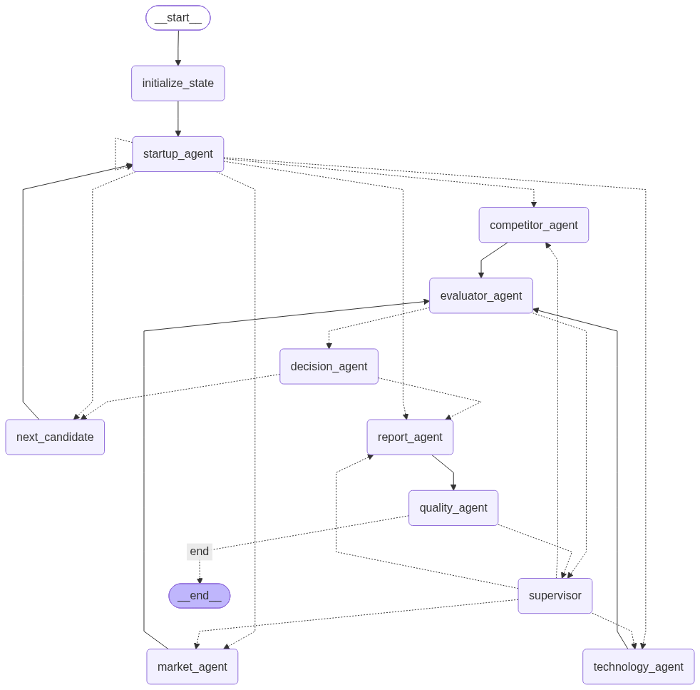
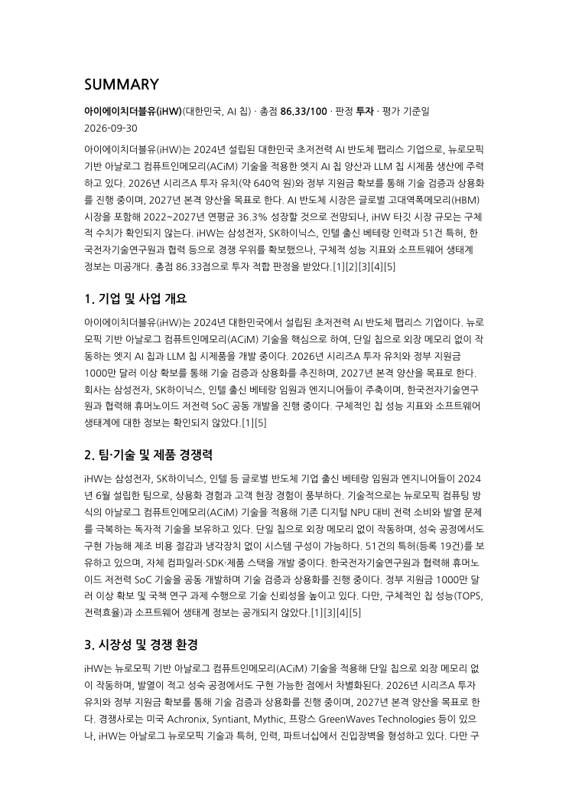
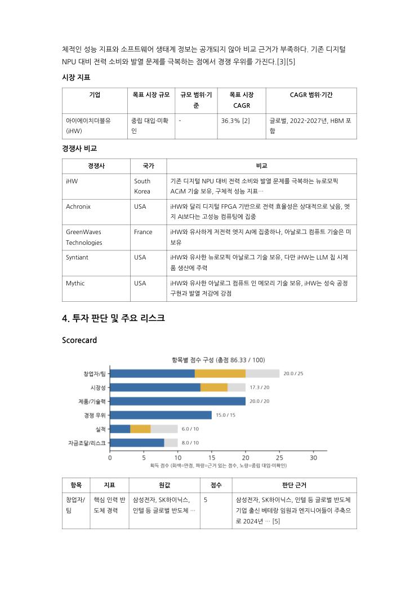
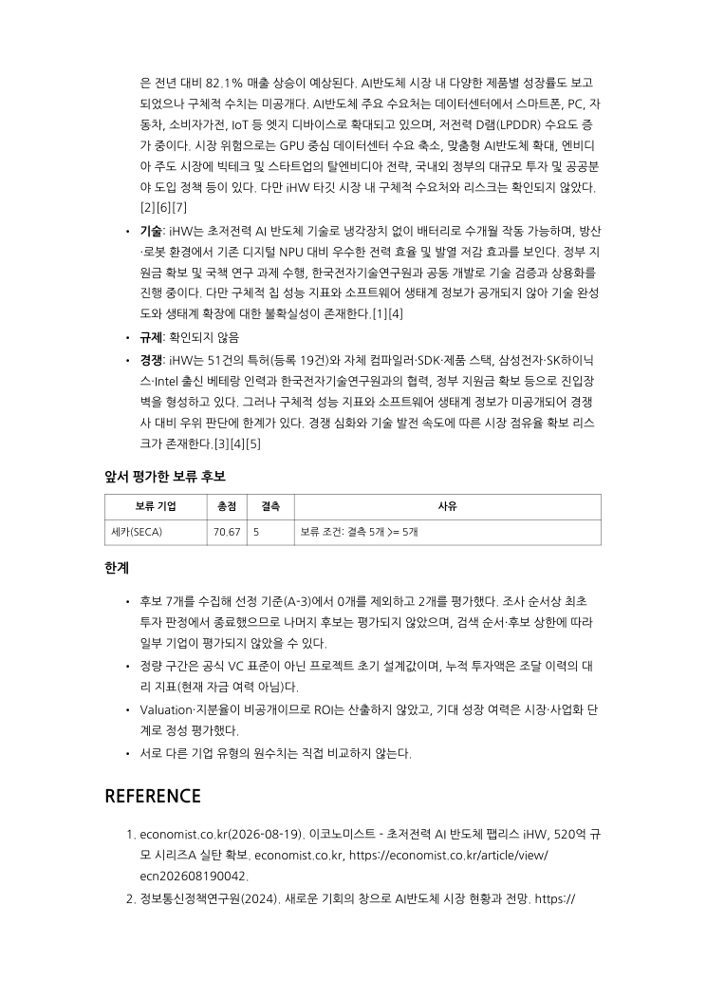

# AI Startup Investment Evaluation Agent

본 프로젝트는 AI 반도체(Semiconductor) 스타트업에 대한 투자 가능성을 자동으로 평가하는 에이전트를 설계하고 구현한 실습 프로젝트입니다. AI 연산용 칩을 설계·개발하거나, AI로 반도체 설계·제조 공정을 개선하는 국내외 비상장 스타트업(Seed~Series C)을 대상으로 합니다.

> 설계 기준 문서: [docs/DESIGN.md](docs/DESIGN.md) · 울산 캠퍼스 4반

## Overview

- Objective : AI 반도체 스타트업의 **팀, 시장성, 제품/기술력, 경쟁 우위, 실적, 자금조달·리스크**를 기준으로 투자 적합성을 분석하고 투자 평가 보고서(PDF)를 자동 생성
- Method : 병렬 fan-out/fan-in과 필수 근거 Gate Supervisor를 결합한 LangGraph Multi-Agent, Agentic RAG(Hybrid 검색 + 관련성 평가 + 재검색 + 웹 보완), 근거(Evidence) 기반 13개 지표 채점, 코드 규칙에 의한 투자/보류 판정, 보고서 품질 평가

### Pattern 및 선정 이유

- **Pattern: Parallel fan-out/fan-in + Supervisor**
- Technology·Market·Competitor라는 역할과 최초 작업은 미리 정해져 있으므로, 작업을 새로 분해하고 Worker를 동적 생성하는 Orchestrator-Workers가 필요하지 않다. 세 분석을 병렬 실행해 Evaluator에서 합치고, Supervisor는 모든 후보의 **근거 충분성을 확인한 뒤 부족한 영역만 재배정**한다.
- 투자 점수와 판정은 기존 코드 규칙을 유지하며, 충분성 투표는 재분석 대상 선택에만 쓰고 점수를 바꾸지 않는다.

### 동적 처리 — 고정 순서와의 차이

이전 그래프는 `Technology → Market → Competitor → Evaluator`를 항상 같은 순서로 실행했다. 현재 그래프는 후보 Gate 통과 후 세 분석을 같은 superstep에 fan-out하고, 모두 끝난 뒤 Evaluator에서 한 번 fan-in한다.

- 채점 후 결측 영역이 기술·시장·경쟁 중 하나 이상이면 Supervisor가 해당 subset만 동시에 재배정한다.
- 결측이 없어도 세 분석의 충분성 투표를 확인하고, 충분하거나 영역별 재분석 예산이 소진된 뒤에만 Decision으로 진행한다.
- 보고서 품질이 미달이면 Supervisor가 Report를 한 번 재작성하게 한 뒤 Quality를 다시 실행한다.
- 따라서 실행 경로와 노드 호출 횟수는 후보의 선정 결과·근거 충분성·결측·품질 결과에 따라 달라진다.

## Problem & Approach

- **문제**: AI 반도체 스타트업 투자 검토는 기술 검증·시장성·경쟁력 정보가 홈페이지·기사·산업 보고서에 흩어져 있어 수작업 조사가 오래 걸리고, 평가자마다 점수 기준이 달라집니다.
- **접근**: 후보 탐색과 기술·시장·경쟁 분석을 Agent별로 분담하고, 공통 **Evidence(출처 포함)** 와 평가표로 통합합니다. LLM은 정보 추출·요약·정성 채점만 맡고, **점수 계산·투자/보류 판정·분기는 코드**가 처리합니다.

## 차별점 (Differentiators)

1. **Corrective Agentic RAG — 부족한 topic만 다시 검색**

   시장 분석 질의를 규모·성장률·수요/리스크 3개 topic으로 나눠 Hybrid 검색(Dense + BM25, Weighted RRF)을 하고, topic별로 관련성을 평가합니다. 기준에 못 미친 topic만 질의를 재작성해 최대 2회 재검색하고, 그래도 부족하면 웹 검색으로 보완합니다. 임베딩은 한·영 혼합 과제 문서로 3종을 직접 비교해 Qwen3-Embedding-0.6B를 골랐습니다.

2. **LLM과 코드의 역할 분리**

   LLM은 지표별 근거(URL·원문 발췌)를 추출하고 보고서 문장을 씁니다. 가중 합산 점수와 투자/보류 분기(`총점 ≥ 70` · `미확인 < 5` · `선정 불확실성 없음`)는 코드가 계산하므로 입력이 같으면 결론도 같습니다. 시장 수치는 인용 원문에 그 숫자가 실제로 있는지 코드로 대조해 LLM이 만든 수치를 걸러냅니다.

3. **3-상태 채점: 확인 / 부재 확인 / 미확인**

   "없음이 확인됨"(1점)과 "정보를 못 찾음"(미확인)을 구분합니다. 미확인 지표는 중립 3점을 넣고 보고서에 표시하며, 미확인 지표만 골라 근거 보완 검색을 1회 더 실행합니다. 그래도 5개 이상 남으면 판정을 보류합니다. API 오류나 빈 검색 결과도 미확인으로 처리합니다.

4. **기업 유형별 해석 + 공통 13개 지표**

   후보를 칩(CHIP)·AI 설계/EDA(DESIGN_AI)·AI 공정(PROCESS_AI)으로 분류하고, 유형마다 개발 단계·기술 검증 조건·진입장벽·리스크를 다르게 해석합니다. 13개 지표와 가중치는 고정이라 유형 분류가 점수를 유리하게 바꾸지 못합니다.

## Features

- **국내외 후보 탐색**: 한국어·영어 웹검색으로 후보를 최대 10개 수집하고, 6개 선정 기준(도메인·AI 핵심성·비상장·투자 단계·Exit 미완료·정보 충분성)으로 PASS/FAIL/REVIEW 판정
- **PDF 자료 기반 시장 분석(Agentic RAG)**: 정부·연구기관·컨설팅 보고서 4종(100페이지)을 Hybrid 검색(Dense + BM25, Weighted RRF)으로 조회하고, topic별 관련성 평가 → 질의 재작성 → 웹 보완
- **근거 기반 채점**: 모든 지표는 출처가 연결된 Evidence로만 채점하고, 근거가 없으면 중립 3점 + `missing`으로 구분. 정량 점수·총점·투자/보류 분기는 LLM이 아닌 코드가 계산
- **분기·루프**: 최초 분석 3종은 병렬 실행하고, Supervisor는 충분성 투표·결측을 함께 검사해 필요한 subset만 병렬 재분석한다. 전역 고정 스텝 종료 없이 선정 재검색(1회), 시장 재검색(topic별 2회), 근거 재분석(후보당 1라운드), 후보 수, 품질 재작성(1회)으로 종료를 보장한다
- **투자 보고서 자동 생성**: 완료된 평가 스냅샷만 받아 SUMMARY~REFERENCE 구조의 10페이지 이내 PDF를 생성한다. 주장별 실제 Evidence만 인용하고, 인용 수치 일치·중립성·편향 통제를 평가한다

## Tech Stack

- Framework : LangGraph, LangChain (Python 3.11, uv)
- LLM/Generator : gpt-4.1-mini (분석·보고서 작성)
- LLM/Judge : gpt-4.1-mini (정성 채점·관련성 평가, temperature=0)
- Retrieval : FAISS(Dense) + BM25(Sparse), Weighted RRF (0.5/0.5, c=60), Top-5 — 사전 벤치마크 Hit Rate@1/3/5 = 0.85 / 1.00 / 1.00, MRR = 0.925 (Qwen3, 125청크 파일럿·합성 질문 20개 기준, [outputs/embedding_eval.csv](outputs/embedding_eval.csv))
- Embedding : Qwen/Qwen3-Embedding-0.6B (오픈소스, 로컬 실행)
- Web Search : Tavily
- Report : PyMuPDF(PDF 변환), matplotlib(차트), 나눔고딕(한글 폰트, OFL)
- Tracing : LangSmith

### Embedding 선정

BAAI/bge-m3, intfloat/multilingual-e5-large, Qwen/Qwen3-Embedding-0.6B 3종을 동일한 청크·질문·정답으로 비교했습니다. 리더보드 순위가 아니라 **본 과제 문서(한·영 혼합 4종)에서의 실측 검색 성능**으로 선택했습니다.

| 모델                           |    Hit@1 |    Hit@3 |    Hit@5 |       MRR | 인덱싱(초) |
| ------------------------------ | -------: | -------: | -------: | --------: | ---------: |
| BAAI/bge-m3                    |     0.75 |     0.95 |     0.95 |     0.842 |       48.4 |
| intfloat/multilingual-e5-large |     0.70 |     0.95 |     0.95 |     0.817 |       43.7 |
| **Qwen/Qwen3-Embedding-0.6B**  | **0.85** | **1.00** | **1.00** | **0.925** |      110.4 |

인덱싱 시간은 최초 1회 비용이며 인덱스를 재사용합니다. 현재 RAG 적재본은 4개 문서, PDF 100페이지, 117청크(chunk_size=1000, overlap=100)입니다. 평가는 125청크 파일럿·합성 질문 20개 기준의 상대 비교이며 Hybrid 적용 효과는 별도로 검증하지 않았습니다.

## Agents

- **Supervisor** : Evaluator 뒤 필수 근거 Gate로서 충분성 투표와 결측을 검사한다. 필요한 분석 워커들을 병렬 재배정하고, 충분하거나 재시도 소진 시 Decision, Quality 실패 시 Report 수정을 배정한다
- **Startup Agent** : 국내외 후보 수집·정규화·중복 제거, A-3 선정 기준 판정과 기업 유형(CHIP / DESIGN_AI / PROCESS_AI) 분류, 팀·인력·투자·고객·매출 근거 수집
- **Technology Agent** : 기업 유형별 기술 지표·개발 단계·검증 조건 수집, 기업 주장과 검증된 효과 구분, 기술 영역 충분성 투표
- **Market Agent (RAG)** : `market_size` / `market_growth` / `demand_risk` topic별 Hybrid RAG → 관련성 평가 → 재검색 → 웹 보완, 범위·기준연도가 다른 수치는 결합하지 않음, 시장 영역 충분성 투표
- **Competitor Agent** : 같은 유형·고객 문제의 국내외 경쟁 3~5개(기존 비AI 방식 포함) 비교, 진입장벽 근거 수집, 경쟁 영역 충분성 투표
- **Evaluator Agent** : 13개 지표 채점(정량·범주는 코드, 정성은 1/3/5 루브릭), 결측 처리, 가중 총점 계산
- **Decision Agent** : `total_score ≥ 70` · `결측 < 5` · `uncertain == False` 세 조건을 코드로 판정하고 후보별 스냅샷 저장. 충분성 투표는 이 판정을 바꾸지 않는다
- **Report Agent** : 투자 기업 중심 / 전원 보류 비교 / 평가 대상 없음 3유형을 생성한다. PASS·REVIEW 후보의 평가가 미완료이면 생성을 거부하고, 품질 수정 시 기존 판정·점수를 유지한다
- **Quality Agent** : Groundedness(코드), 중립성(LLM), 편향 통제(코드). 미달이면 Supervisor가 보고서를 1회 재작성하게 한다

## State Schema

가이드의 예시 State는 관점 합성용 참고라 그대로 쓰지 않았다. 이 그래프의 State는 투자 평가 본문과, Gate·Supervisor가 분기와 재작업을 결정하는 제어 정보로 나뉜다.

작업 결과는 `candidates`, `current_startup`, 기술·시장·경쟁 분석, Evidence, `scores`, `decision`, `evaluated`, `final_report`다. 제어 정보는 `trace_id`, `node_status`, `last_error`, `next_routes`, `route_reason`, 재시도 카운터, `current_idx`, `sufficiency_votes`, `refresh_areas`, `evidence_gate_status`, `quality_retry`다.

| 항목 | 이 그래프에서의 답 |
| --- | --- |
| 제어 vs 페이로드 분리 | 라우팅에 필요한 최소 상태는 제어 필드다. 기업 분석, 근거, 점수, 보고서 문장은 작업 결과로 둔다 |
| 관측성 위치 | 배정 이력은 LangSmith에 남긴다. State에는 최신 재작업 목록 `next_routes`와 사유 `route_reason`, 마지막 오류, 워커의 충분성 투표를 둔다 |
| 지속성 비용 | 검색 원문과 RAG 청크는 State에 누적하지 않는다. 후보가 바뀌면 그 후보의 Evidence를 비우고, 보고서용 스냅샷만 `evaluated`에 후보당 1건 남긴다 |
| 상관 | `initialize_state`가 `trace_id`를 만든다. LangSmith 추적과 같은 실행을 이 값으로 구분한다 |
| 재개/복구 | `node_status`, `last_error`, `current_idx`, `selection_retry`, `rag_retry`, `evidence_retry`, `evidence_gate_status`, `quality_retry`가 있으면 어느 후보의 어느 단계인지 알 수 있다 |
| 동시 처리 | 분석 3종은 서로 다른 결과·Evidence 필드에 쓰며, `sufficiency_votes`는 dict merge reducer로 워커별 key를 합친다. `evaluated`는 `operator.add`로 후보별 스냅샷을 잇는다 |
| 종료 보장 | 전역 스텝 수로 Report를 강제하지 않는다. 후보 수와 선정·시장·근거·품질의 영역별 재시도 상한으로 루프를 끝낸다 |

## Architecture



`initialize_state → Startup Gate` 이후, 통과 후보는 Technology·Market·Competitor로 병렬 분기되고 Evaluator에서 합쳐진다. 모든 평가 후보는 Supervisor 근거 Gate를 통과한 뒤 Decision으로 간다. (상세: [docs/DESIGN.md](docs/DESIGN.md) D장)

- 선정 REVIEW는 Startup, 보류는 다음 후보로 직접 분기한다. Supervisor는 불충분 투표·결측 영역과 품질 미달에만 재작업을 배정한다
- 투자 판정 또는 후보 소진 뒤에 보고서를 쓰고, 품질 평가를 통과하거나 재작성 1회를 마치면 종료한다
- 기술·시장·경쟁의 충분성 투표는 재배정에만 쓰고, 투자/보류는 코드 규칙을 유지한다

## 실행 결과 (2026-10-13 검증)

실제 API와 RAG를 사용해 필수 근거 Gate와 최종 보고서 생성을 종단 간 검증했다.

```text
initialize_state → startup_agent
→ [technology_agent ∥ market_agent ∥ competitor_agent]
→ evaluator_agent → supervisor(evidence gate) → market_agent → evaluator_agent
→ supervisor(evidence gate)
→ decision_agent → report_agent → quality_agent
```

| 단계      | 결과                                                                                                      |
| --------- | --------------------------------------------------------------------------------------------------------- |
| 후보 수집 | 국내외 검색으로 10개 수집, 선정 기준 FAIL 2개 제외                                                       |
| 평가 | **하이퍼엑셀(HyperExcel)** — 총점 **82.17**, 결측 3개, 선정 불확실성 없음 → **투자**                    |
| 근거 Gate | Market 영역만 선택적으로 1회 재분석한 뒤, 잔여 결측을 유지하고 Decision 진행                             |
| 보고서 | **7페이지**, Groundedness·중립성·편향 통제 통과, 최대 10페이지 준수                                      |

### 투자 보고서 핵심 포인트

- **판정**: 하이퍼엑셀(대한민국, AI 칩) — 총점 82.17/100, 투자.
- **결측 3개(목표 시장 규모, 목표 시장 CAGR, 매출 발생)** 는 3점을 중립 대입하고 보고서에 '중립 대입·미확인'으로 표시했습니다.
- **시장 범위 검증**: 타깃 시장과 범위가 다른 시장 수치는 채점과 보고서 정량 서술에서 제외했습니다.
- **주요 리스크**: ASIC 양산 전 단계, 구체적 시장 정량값과 매출 미확인, 글로벌 AI 가속기 경쟁, 규제 근거 미확인.
- 보고서 구성: SUMMARY → 1. 기업 및 사업 개요 → 2. 팀·기술 및 제품 경쟁력 → 3. 시장성 및 경쟁 환경 → 4. 투자 판단 및 주요 리스크 → REFERENCE (7페이지, 실제 인용 출처만 기재)

> 웹검색과 LLM 응답은 실행마다 달라져 후보·점수가 매번 같지는 않습니다. 위 내용은 제출본 PDF와 같은 실행 기준입니다.

### 이전 제출본 투자 보고서 미리보기

| 1페이지: SUMMARY ~ 3장                | 2페이지: 4장 Scorecard·차트           | 4페이지: 한계·REFERENCE               |
| ------------------------------------- | ------------------------------------- | ------------------------------------- |
|  |  |  |

전체 4페이지 미리보기: [1](docs/report_preview/page-1.png) · [2](docs/report_preview/page-2.png) · [3](docs/report_preview/page-3.png) · [4](docs/report_preview/page-4.png)

## Directory Structure

```text
├── agents/             # Agent 모듈(startup, technology, competitor, report), State, Graph, config
│   └── stubs.py        # Market·Evaluator·Decision 및 공통 노드(initialize_state, next_candidate)
├── data/
│   ├── raw/            # 원본 PDF
│   ├── docs/           # RAG 적재용 PDF (4종, 100페이지)
│   └── vectorstores/   # FAISS·BM25 인덱스
├── prompts/            # 프롬프트 템플릿
├── rag/                # 문서 적재·청킹, Hybrid 검색, 임베딩 평가
├── tools/              # web_search, 차트, PDF 변환
├── tests/              # 단위 테스트, 보고서 fixture
├── assets/fonts/       # 보고서용 한글 폰트
├── outputs/            # 실행 결과(보고서 PDF·MD, 후보 목록, 그래프 이미지)
├── docs/DESIGN.md      # 설계 문서(구현 기준)
├── app.py              # 실행 스크립트
└── README.md
```

## Usage

```bash
# 1. 의존성 설치
uv sync

# 2. 환경 변수 설정 (.env는 커밋하지 않습니다)
cp .env.example .env
# OPENAI_API_KEY, TAVILY_API_KEY 등을 입력

# 3. (선택) RAG 인덱스 재생성 — 저장소에 인덱스가 포함되어 있어 보통 필요 없습니다
uv run python -m rag.ingest

# 4. 실행: 후보 탐색 → 분석 → 채점 → 판정 → 보고서 생성
uv run python app.py
```

- 결과: `outputs/RAG-Output_울산캠퍼스-4반_박연제+이정인+정예지+박태준.pdf` (+ 같은 이름의 `.md`)
- 평가 수 상한은 환경 변수 `MAX_CANDIDATES`(1~10, 기본 5), 기준일은 `AS_OF_DATE`(YYYY-MM-DD)로 조정합니다.
- 최초 실행 시 임베딩 모델(Qwen3-Embedding-0.6B)이 다운로드됩니다.
- 웹 검색과 LLM 응답은 실행마다 달라질 수 있어 후보·점수가 매번 같지는 않습니다.
- `--scenario invest|all_hold|zero_pass|evidence_retry|no_candidates|uncertain` 옵션은 그래프 분기 검증용 stub 후보이며, 결과는 `stub-*` 파일로 분리 저장됩니다.
- 보고서 유형별 렌더링 확인: `uv run python -m tests.run_report_fixtures` (가상 데이터, `outputs/fixtures/`)
- 단위 테스트: `uv run --with pytest python -m pytest -q`

## Lessons Learned

- **State 형식 불일치**: Agent 통합 시 `tech_summary`가 dict가 아닌 문자열로 전달되어 Decision 노드에서 실행 중단. State·Evidence 규격에 맞춰 수정. 개발 초기 공통 fixture와 스키마 테스트의 선행 구축 필요.
- **LLM 실패 시 기본값**: 초기 코드는 LLM 호출 실패 시 기본 후보·기술 정보를 채워 넣는 구조. 실제 근거로 오인될 위험이 있어 전부 제거, 실패 시 결측으로 기록하도록 변경.
- **단위 환산 버그**: `"1,228억"`과 `"달러"`가 1,228달러로 환산되어 시장 규모가 $0M으로 채점. 환산 로직 수정, 인용 원문–수치 대조 검증 및 회귀 테스트 추가.
- **웹 검색 발행일**: 웹 검색 결과 다수에서 발행일 누락. URL·본문·페이지 메타데이터 기반 날짜 추출, 미확인 시 조회일로 표기.
- **판정 로직 분리**: 점수 계산·판정·분기의 코드 기반 처리로, 실행마다 검색 결과가 달라도 결과 도출 과정 추적 가능.
- **정성 지표 점수**: 하이퍼엑셀의 일부 정성 지표는 기업·투자사 발표 근거 비중이 높아, 외부 자료 교차 검증을 강화할 필요가 있습니다.

## Limitations

- 정량 구간·투자 임계값(70점, 결측 5개)은 검증된 VC 표준이 아닌 프로젝트 정책값이며, 공통 점수는 선별 보조값입니다.
- Valuation·지분율이 비공개이므로 ROI는 계산하지 않고, 누적 투자액은 조달 이력의 대리 지표로만 사용합니다.
- 조사 순서상 최초 투자 판정에서 종료하므로 투자 기업이 전체 후보 중 최우수 기업이라는 뜻은 아닙니다.
- RAG 문서 4종은 AI 반도체 산업 배경 중심이라 AI 기반 EDA·공정 개선의 세부 시장은 웹 보완으로 확인하며, 확인하지 못한 지표는 결측으로 처리합니다.
- 글로벌 **HBM 시장** CAGR 36.3%(2022~2027)는 하이퍼엑셀의 LPU 타깃 시장과 범위가 달라 제출본의 목표 시장 성장률 점수에서 제외했습니다.
- 정성 지표는 LLM 채점이라 실행마다 다소 달라질 수 있고, 기업 발표 위주의 근거는 우호적으로 평가될 수 있습니다.
- 웹 자료의 발행일은 검색 결과의 공개일 또는 URL·본문에 명시된 날짜로만 표기하며, 확인되지 않으면 조회일을 기재합니다.

## Contributors

정• 박연제 : RAG 인프라·그래프 통합·보고서 생성
   ◦ RAG 문서 준비·청킹·메타데이터 스키마, Qwen3 로컬 임베딩.
   ◦ FAISS + BM25 Hybrid 검색, 인덱스 재사용, 임베딩 3종 비교 평가.
   ◦ 분석 Worker 병렬 실행과 Evaluator → Supervisor 근거 Gate 연결.
   ◦ 병렬 결과 병합 Reducer와 재작업 State 스키마 통합.
   ◦ 미완료 평가의 보고서 생성 차단, 투자·전원 보류·대상 없음 유형별 작성 조건 정리.
   ◦ 검증된 시장 지표만 보고서 입력에 반영, REFERENCE 생성·PDF 편집·보고서 계약 테스트.
   ◦ 설계서·README·그래프 이미지 갱신 및 통합 실행 점검.

• 이정인 : 후보 탐색·기술 분석·경쟁사 분석
   ◦ 웹검색·출처 요약 도구, 국내외 후보 탐색·정규화.
   ◦ Startup Agent의 PASS/FAIL/REVIEW 선정, 기업 유형 분류, 프로필 근거 수집.
   ◦ Technology·Competitor Agent의 기술 검증 조건·차별성·진입장벽 분석.
   ◦ 기술·경쟁 분석 결과의 충분성 투표와 근거 반환 형식 정리.
   ◦ Supervisor가 지정한 재조사 영역에 맞춰 추가 검색 수행.
   ◦ 재조사 시 기존 근거 보존·병합과 분석 Worker 입출력 점검.

• 정예지 : 시장 근거 검증·채점·투자 판정
   ◦ Market Agent의 주제별 Corrective RAG, 최대 2회 재검색과 웹 보완.
   ◦ Evaluator Agent의 13개 지표 채점, 단위·통화 환산, 가중 총점 계산.
   ◦ Decision Agent의 투자/보류 규칙과 후보별 평가 스냅샷 저장.
   ◦ 투자유치 금액과 시장 규모 구분, 타깃 시장과 다른 수치의 검증 실패 처리.
   ◦ 검증 실패한 시장 수치를 결측으로 유지하도록 채점 로직 보완.
   ◦ 결측 목록을 Supervisor에 전달하고, 근거 보완 후 재채점하는 흐름 연동.
   ◦ 시장 수치 검증·결측 처리·채점·판정 경계값 회귀 테스트.

• 박태준 : Supervisor 근거 Gate·품질 평가·실행 추적
   ◦ 모든 Evaluator 결과에 대한 필수 근거 Gate 구현.
   ◦ 충분성 투표·결측·재시도 예산을 바탕으로 재분석 대상과 Decision 진행 여부 결정.
   ◦ 재시도 소진 시 잔여 결측을 명시적으로 수용하고 판정으로 진행하도록 종료 조건 정리.
   ◦ 품질 미달 시 기존 점수·판정을 유지하며 보고서 수정 요청 전달.
   ◦ Groundedness의 인용·수치 대조, 잘못된 인용 태그 탐지, 중립성·편향 평가 점검.
   ◦ Supervisor 분기·재작업·종료 테스트, LangSmith Tracing 캡처와 제출 결과 점검.
